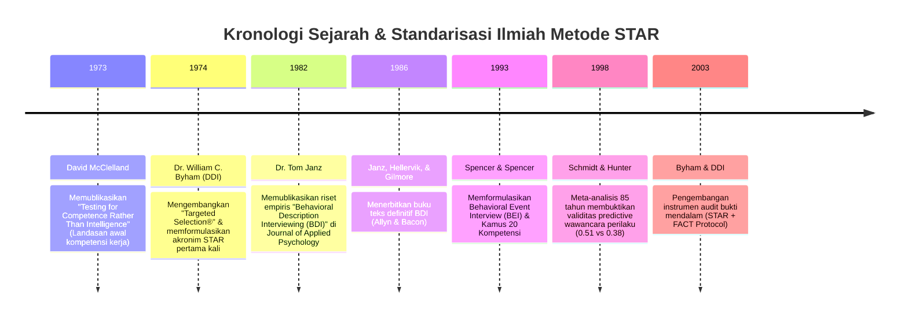

# KAJIAN LITERATUR ILMIAH: METODE STAR & INSTRUMEN PROBING FACT
## Landasan Teoretis Wawancara Perilaku Terstruktur (*Structured Behavioral Interviewing*)
**Dokumen Pendukung Bab II (Tinjauan Pustaka) & Lampiran Skripsi**

---

> **IDENTITAS KAJIAN ILMIAH**  
> * **Peneliti:** Avit Febriansyah  
> * **Dosen Pembimbing:** Ibu Chanifah, M.Kom. (Bu Rina)  
> * **Objek Penelitian:** Sistem Simulasi Wawancara Kerja Interaktif INTERV-U Berbasis AI  
> * **Tujuan Dokumen:** Menjawab instruksi dosen pembimbing bahwa *"Alasan industri sudah pakai STAR tidak cukup"* dengan menyajikan silsilah sejarah ilmiah, rujukan buku/jurnal primer, model matematis validitas, dan integrasi instrumen verifikasi FACT.

---

## BAB I: ASAL-USUL TEORETIS METODE STAR

### 1.1 Aksioma Dasar Psikologi Perilaku (*Behavioral Axiom*)
Metode **STAR** (*Situation, Task, Action, Result*) tidak lahir sebagai tren korporat instan, melainkan berakar dari cabang **Psikologi Industri dan Organisasi (*Industrial-Organizational Psychology*)**.

Prinsip fundamental wawancara perilaku dirumuskan pertama kali oleh para psikolog terapan melalui aksioma ilmiah:
$$\text{"The best predictor of future performance is past behavior in similar circumstances."}$$
*(Prediktor terbaik atas performa seseorang di masa depan adalah perilaku dan tindakan nyatanya di masa lalu pada situasi yang serupa).*

Aksioma ini mendobrak paradigma wawancara konvensional (wawancara tidak terstruktur) yang sejak awal abad ke-20 terbukti rentan terhadap bias subjektif pewawancara, efek halo (*halo effect*), dan manipulasi jawaban hipotesis kandidat.

---

### 1.2 Tokoh Kunci & Kronologi Penemuan Teori STAR



#### 1. Dr. William C. Byham & Targeted Selection® (1974)
Akronim **STAR** pertama kali diformulasikan secara formal pada tahun **1974** oleh **Dr. William C. Byham**, psikolog industri pendiri *Development Dimensions International (DDI)* di Pittsburgh, Pennsylvania. 

Melalui sistem seleksi ilmiah yang dipatenkan dengan nama **Targeted Selection®**, Byham merancang STAR untuk melatih manajer agar mampu mengekstrak bukti perilaku utuh (*Complete Behavioral Examples*) dan mematuhi regulasi kesetaraan kesempatan kerja (*Equal Employment Opportunity Commission / EEOC*) di Amerika Serikat guna menghilangkan bias rasial dan gender.

Byham membagi jawaban kandidat menjadi dua kategori tegas:
* **Complete STAR:** Jawaban yang memuat situasi nyata yang spesifik, tugas yang dihadapi, tindakan mandiri yang diambil, dan hasil akhir terukur.
* **False STAR / Incomplete STAR:** Pernyataan yang hanya berisi teori abstrak (*"Menurut saya komunikasi itu penting"*), kalimat masa depan hipotesis (*"Jika server down, saya akan..."*), atau klaim kerja tim tanpa peran pribadi (*"Tim kami berhasil merilis aplikasi"*).

#### 2. Dr. Tom Janz & Behavioral Description Interviewing / BDI (1982, 1986)
Validasi empiris terkuat yang mengangkat metode ini ke jurnal ilmiah bereputasi tinggi dilakukan oleh **Dr. Tom Janz** dari *University of Calgary*.

Dalam publikasi monumentalnya di jurnal prestisius:
> **Janz, T. (1982). Initial comparisons of patterned behavior-based interviews versus unstructured interviews. *Journal of Applied Psychology*, 67(5), 577–580.**

Janz membuktikan secara statistik bahwa wawancara deskripsi perilaku (*Patterned Behavior Description Interview*) memiliki korelasi validitas prediktif yang jauh melampaui wawancara konvensional. Temuan ini kemudian dibukukan sebagai panduan akademik global:
> **Janz, T., Hellervik, L., & Gilmore, D. C. (1986). *Behavior Description Interviewing: New, Accurate, Cost Effective*. Boston: Allyn and Bacon.**

---

## BAB II: KEDUDUKAN STAR DALAM TAKSONOMI ILMIAH WAWANCARA KERJA

Dalam literatur ilmiah psikologi seleksi pegawai (*Campion, Palmer, & Campion, 1997*), format wawancara kerja terstruktur terbagi menjadi 2 kubu metodologi utama:

| Dimensi Pembeda | Situational Interview (SI) | Behavioral Description Interview (BDI / STAR) |
|:---|:---|:---|
| **Pencetus Utama** | Gary P. Latham (1980) | Tom Janz (1982) & William C. Byham (1974) |
| **Landasan Teori** | *Goal-Setting Theory* (Locke & Latham, 1990) | *Behavioral Consistency Theory* (Wernimont & Campbell, 1968) |
| **Fokus Waktu** | **Masa Depan / Hipotesis (*Future-Oriented*)** | **Masa Lalu / Peristiwa Nyata (*Past-Oriented*)** |
| **Bentuk Pertanyaan** | *"Apa yang akan Anda lakukan jika terjadi konflik teknis di tim?"* | *"Ceritakan pengalaman nyata saat Anda menghadapi silang pendapat teknis yang tajam di tim."* |
| **Kelemahan** | Rentan jawaban hafalan buku (*social desirability bias*). | Menuntut kandidat memiliki rekam jejak pengalaman yang relevan. |
| **Kesesuaian INTERV-U** | **DILARANG KERAS** pada sistem INTERV-U. | **METODOLOGI INTI** yang diwajibkan oleh Bu Rina. |

### Bukti Meta-Analisis Ilmiah (Schmidt & Hunter, 1998)
Dalam studi meta-analisis paling berpengaruh dalam 100 tahun psikologi industri:
> **Schmidt, F. L., & Hunter, J. E. (1998). The validity and utility of selection methods in personnel psychology: Practical and theoretical implications of 85 years of research findings. *Psychological Bulletin*, 124(2), 262–274.**

Tercatat bahwa:
* Wawancara tidak terstruktur hanya memiliki koefisien validitas prediktif **$r = 0.38$**.
* Wawancara perilaku terstruktur berbasis kompetensi (STAR / BDI) memiliki validitas prediktif mencapai **$r = 0.51$**.
Artinya, penggunaan metode STAR meningkatkan akurasi prediksi keberhasilan kerja kandidat hingga **34% lebih tinggi** dibanding wawancara bebas.

---

## BAB III: BEDAH STRUKTURAL 4 KOMPONEN STAR

Dalam sistem INTERV-U, setiap transkrip jawaban kandidat diekstraksi ke dalam 4 dimensi baku:

```
┌─────────────────────────────────────────────────────────────────────────┐
│ S · SITUATION (Konteks & Latar Belakang Masalah)                         │
│ • Di mana dan kapan peristiwa itu terjadi?                              │
│ • Seberapa kritis atau mendesak situasinya saat itu?                    │
├─────────────────────────────────────────────────────────────────────────┤
│ T · TASK (Peran, Tugas, & Tanggung Jawab Pribadi)                       │
│ • Apa tanggung jawab spesifik yang dibebankan kepada kandidat?          │
│ • Apa tantangan atau batasan (waktu/sumber daya) yang dihadapi?         │
├─────────────────────────────────────────────────────────────────────────┤
│ A · ACTION (Tindakan Nyata yang Dieksekusi Mandiri)                     │
│ • Langkah konkret apa yang diambil oleh kandidat secara pribadi?        │
│ • Mengapa memilih solusi tersebut dibanding alternatif lain?            │
├─────────────────────────────────────────────────────────────────────────┤
│ R · RESULT (Hasil Akhir Terukur & Pembelajaran)                         │
│ • Apa dampak nyata dari tindakan tersebut terhadap sistem/organisasi?   │
│ • Adakah metrik kuantitatif (angka, efisiensi waktu, skor Lighthouse)?  │
└─────────────────────────────────────────────────────────────────────────┘
```

---

## BAB IV: TURUNAN METODE VALIDASI: INSTRUMEN PROBING FACT

### 4.1 Mengapa STAR Saja Belum Cukup?
Dalam konteks wawancara berbasis AI generatif, kandidat cerdas sering kali dapat menghafal struktur STAR secara mekanis (*scripted answer*). Kandidat bisa menceritakan cerita fiktif yang memiliki Situation, Task, Action, dan Result yang terdengar rapi.

Untuk membongkar kebohongan narasi atau klaim sepihak atas keberhasilan tim (*freerider*), Byham (2003) dan protokol *Behavioral Event Interview* (Spencer & Spencer, 1993) mengamanatkan instrumen audit bukti yang disebut **FACT Probing Protocol**.

### 4.2 Empat Pilar Audit Dimensi FACT:

$$\text{Total Skor FACT} = \text{Score}_{\text{Feeling}} + \text{Score}_{\text{Action}} + \text{Score}_{\text{Context}} + \text{Score}_{\text{Thinking}} \quad (\text{Skor Maksimal: } 40)$$

#### 1. F &mdash; Feeling / Focus (Skor 1–10)
* **Definisi:** Memeriksa keterlibatan emosional, ketenangan, fokus perhatian, dan sikap mental kandidat saat menghadapi tekanan krisis di dunia kerja nyata.
* **Logika Audit:** Orang yang benar-benar mengalami insiden kritis (misal: server produksi down 2 jam sebelum peluncuran) dapat menceritakan tekanan mental dan ketenangannya secara alami. Orang yang berbohong cenderung datar dan tanpa emosi.
* **Pertanyaan Probing Pewawancara AI:**
  > *"Apa yang menjadi fokus perhatian utama dan bagaimana Anda mengelola stres Anda saat menghadapi insiden tersebut?"*

#### 2. A &mdash; Action Specificity (Skor 1–10)
* **Definisi:** Memeriksa apakah tindakan yang diambil adalah **kontribusi nyata diri sendiri**, bukan mendompleng hasil kerja tim (*collective claims*).
* **Logika Audit:** Membedakan kata *"kami melakukan refactoring"* dengan *"saya secara pribadi menulis modul autentikasi JWT"*.
* **Pertanyaan Probing Pewawancara AI:**
  > *"Tadi Anda menyebut 'kami merancang database', bisa Anda jelaskan persisnya bagian mana yang Anda desain dan kerjakan sendiri langkah demi langkah?"*

#### 3. C &mdash; Context & Consequence (Skor 1–10)
* **Definisi:** Menguji kedalaman pemahaman kandidat mengenai lingkungan teknis dan konsekuensi fatal jika masalah tersebut gagal diselesaikan.
* **Logika Audit:** Pengalaman nyata selalu disertai pemahaman atas risiko bisnis (*business risk*) dan dampak nyata bagi pengguna akhir.
* **Pertanyaan Probing Pewawancara AI:**
  > *"Berapa skala sistem tersebut saat itu dan apa dampak fatal bagi operasional perusahaan jika bug tersebut tidak terselesaikan tepat waktu?"*

#### 4. T &mdash; Thinking & Reasoning (Skor 1–10)
* **Definisi:** Menguji proses penalaran rasional, pertimbangan trade-off, dan logika arsitektural yang melandasi keputusan kandidat.
* **Logika Audit:** Mencegah jawaban hafalan. Kandidat harus mampu menjelaskan *mengapa* mereka memilih teknologi A dan menolak teknologi B.
* **Pertanyaan Probing Pewawancara AI:**
  > *"Pertimbangan teknis apa yang mendasari Anda memilih Zustand dibanding Redux dalam skenario tersebut? Trade-off apa yang Anda hadapi?"*

---

## BAB V: INTEGRASI MATEMATIS STAR + FACT DALAM SISTEM INTERV-U

Di dalam arsitektur INTERV-U, STAR dan FACT tidak berdiri terpisah, melainkan bekerja sebagai **saringan validitas bertingkat (*multi-stage validation filter*)**:

```
[Suara Kandidat] 
       │
       ▼
[Filter 1: STAR Parser] ──> Menghitung Kelengkapan Struktur Narasi (Skor 0 s/d 4)
       │
       ▼
[Filter 2: FACT Audit]   ──> Menghitung Derajat Keaslian Bukti Nyata (Skor 4 s/d 40)
       │
       ▼
[Filter 3: Spencer 1993] ──> Mencocokkan Bukti Tindakan ke Level Perilaku 1–5
       │
       ▼
[Mesin Skor SAW]         ──> S_final = S_base x μ_FACT (Terkalibrasi Bobot Posisi)
```

Jika kandidat hanya bercerita dengan STAR yang lengkap namun skor FACT rendah (misal tindakan tidak spesifik / mendompleng tim), maka faktor pengali $\mu_{\text{FACT}}$ akan memotong nilai kandidat hingga **-15%**. Sebaliknya, kandidat yang membuktikan aksi mandiri mendalam akan menerima pengali bonus hingga **+15%**.

---

## BAB VI: SITASI & DAFTAR PUSTAKA BAKU (UNTUK BAB II SKRIPSI)

Berikut adalah daftar pustaka primer berstandar APA 7th Edition yang siap langsung Anda salin ke daftar pustaka draf skripsi Anda:

1. **Byham, W. C. (1974).** *Targeted Selection: A behavior-based selection system*. Pittsburgh, PA: Development Dimensions International (DDI) Press.
2. **Campion, M. A., Palmer, D. K., & Campion, J. E. (1997).** A review of structure in the selection interview. *Personnel Psychology*, 50(3), 655–702. https://doi.org/10.1111/j.1744-6570.1997.tb00709.x
3. **Janz, T. (1982).** Initial comparisons of patterned behavior-based interviews versus unstructured interviews. *Journal of Applied Psychology*, 67(5), 577–580. https://doi.org/10.1037/0021-9010.67.5.577
4. **Janz, T., Hellervik, L., & Gilmore, D. C. (1986).** *Behavior description interviewing: New, accurate, cost effective*. Boston: Allyn and Bacon.
5. **Locke, E. A., & Latham, G. P. (1990).** *A theory of goal setting & task performance*. Englewood Cliffs, NJ: Prentice-Hall, Inc.
6. **McClelland, D. C. (1973).** Testing for competence rather than for "intelligence." *American Psychologist*, 28(1), 1–14. https://doi.org/10.1037/h0034092
7. **Schmidt, F. L., & Hunter, J. E. (1998).** The validity and utility of selection methods in personnel psychology: Practical and theoretical implications of 85 years of research findings. *Psychological Bulletin*, 124(2), 262–274. https://doi.org/10.1037/0033-2909.124.2.262
8. **Spencer, L. M., & Spencer, S. M. (1993).** *Competence at work: Models for superior performance*. New York: John Wiley & Sons, Inc.
9. **Wernimont, P. F., & Campbell, J. P. (1968).** Signs, samples, and criteria. *Journal of Applied Psychology*, 52(5), 372–376. https://doi.org/10.1037/h0026244
